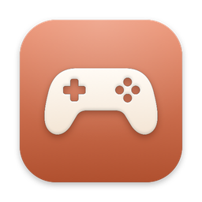
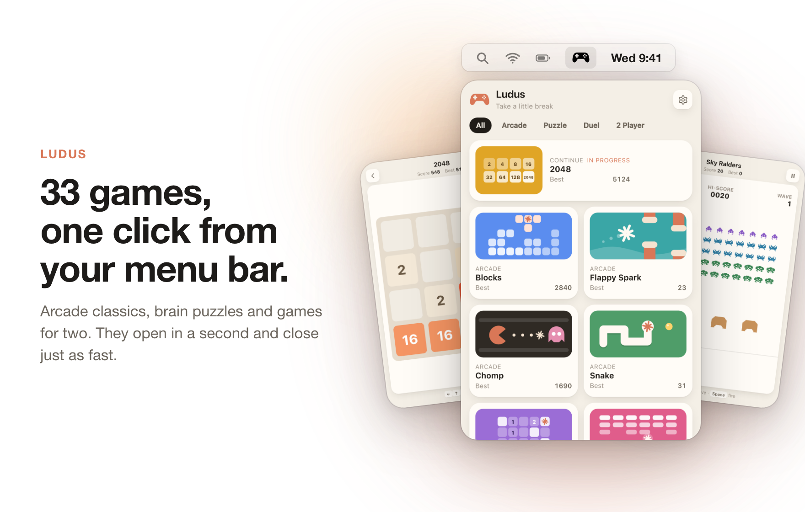
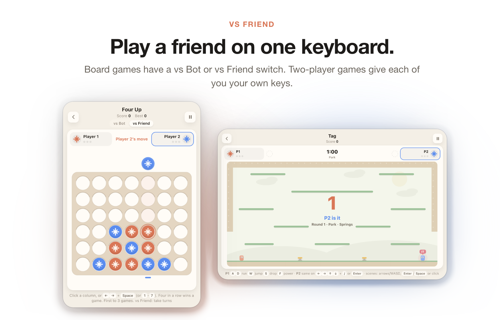
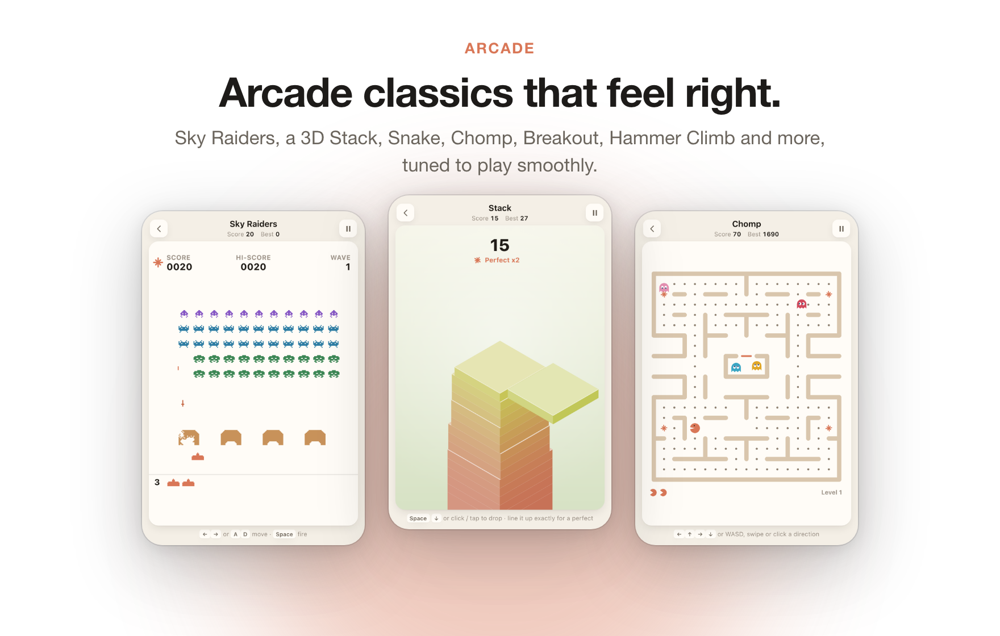
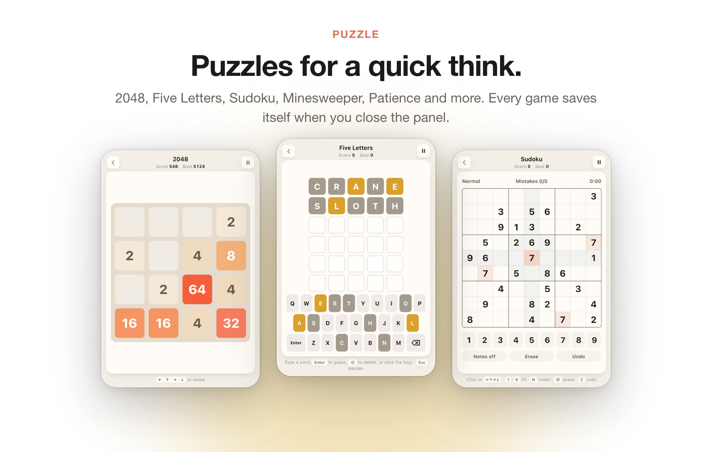
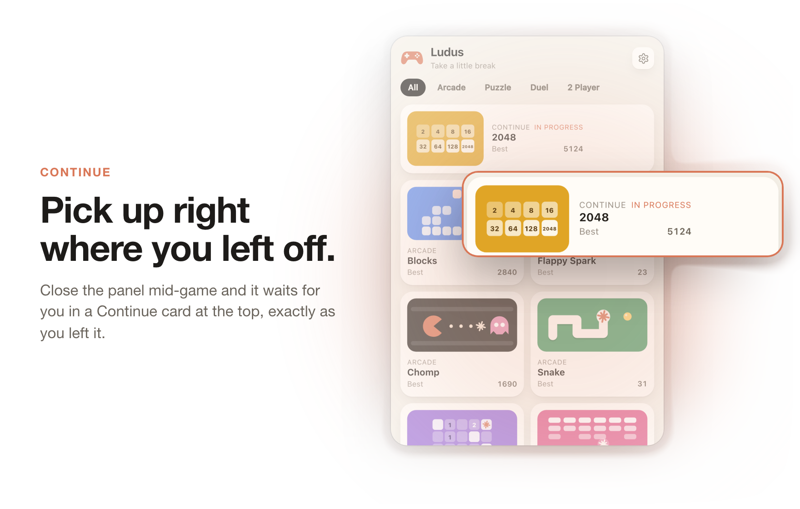
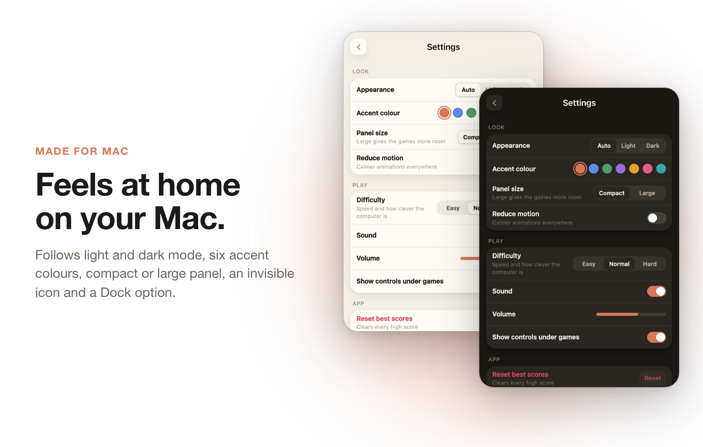

<div align="center">

<picture>
  <source media="(prefers-color-scheme: dark)" srcset="docs/img/icon-dark.png">
  
</picture>

<h1>Ludus</h1>

<p><b>44 little games in your menu bar. Take a little break.</b></p>

<p>
  <a href="https://github.com/Solomon-69/Ludus/releases/latest"></a>
  
  
</p>

<p>
  <a href="https://github.com/Solomon-69/Ludus/releases/latest/download/Ludus.dmg"><b>Download for Mac</b></a>
  &nbsp;&middot;&nbsp;
  <a href="https://github.com/Solomon-69/Ludus/releases/latest/download/Ludus-windows.zip"><b>Download for Windows</b></a>
</p>

<br>

<picture>
  <source media="(prefers-color-scheme: dark)" srcset="docs/showcase/ludus-1-dark.png">
  
</picture>

</div>

Ludus is a small panel of games that lives in the Mac menu bar (and the Windows system tray).
Click the controller, play a quick round, then click anywhere else. The panel tucks itself
away and your game waits, paused, exactly where you left it.

It is free, source-available, works fully offline by default and collects nothing. Playing a friend over the internet is an opt-in extra (see [Play online](#play-online-with-a-room-code)).

## Contents

- [Features](#features)
- [Install](#install)
- [The games](#the-games)
- [Usage and keyboard shortcuts](#usage-and-keyboard-shortcuts)
- [Settings](#settings)
- [Privacy](#privacy)
- [Requirements](#requirements)
- [FAQ and troubleshooting](#faq-and-troubleshooting)
- [Building from source](#building-from-source)
- [Contributing](#contributing)
- [Credits](#credits)
- [Licence](#licence)

## Features

Ludus puts 44 small, polished games one click away. Here is what is inside.

<picture>
  <source media="(prefers-color-scheme: dark)" srcset="docs/showcase/ludus-2-dark.png">
  
</picture>

### Play a friend on one keyboard

Every board game has a <b>vs Bot / vs Friend</b> switch at the top. Pick Friend and you take turns on the same keyboard, with Player 2 in blue. The real-time games in the Same laptop tab give each of you your own keys, so you can both play at once.

- <b>Turn-based with a friend:</b> Chess, Four in a Row, Dots and Boxes, Ultimate Tic-Tac-Toe, Hex and Dead Centre.
- <b>Secret picks:</b> in Rock Paper Scissors, Player 1 picks with <kbd>A</kbd> <kbd>S</kbd> <kbd>D</kbd> and Player 2 with <kbd>J</kbd> <kbd>K</kbd> <kbd>L</kbd>. Both hands show only once you have both locked in.
- <b>Real time:</b> Paddle Duel, Air Hockey, Tag, Sword Duel and Tank Arena, with one player on <kbd>W</kbd> <kbd>A</kbd> <kbd>S</kbd> <kbd>D</kbd> and the other on the arrow keys. Tag takes up to four on one keyboard: P3 on <kbd>I</kbd> <kbd>J</kbd> <kbd>K</kbd> <kbd>L</kbd> (+<kbd>U</kbd>) and P4 on the number pad <kbd>8</kbd> <kbd>4</kbd> <kbd>5</kbd> <kbd>6</kbd> (+<kbd>0</kbd>).
- The real-time ones are in the <b>Same laptop</b> tab; the board games keep their vs Friend switch. The panel widens by itself when a game needs the room.

<br>

<picture>
  <source media="(prefers-color-scheme: dark)" srcset="docs/showcase/ludus-3-dark.png">
  
</picture>

### Play online with a room code

Eighteen games can be played online from the <b>Online</b> tab: the board games Chess, Four in a Row, Dots and Boxes, Ultimate Tic-Tac-Toe, Hex, Wall Race, Rock Paper Scissors, Dead Centre and Last Wire, the action games Paddle Duel, Air Hockey and Pop Duel, the guessing games Map Hunt and Clue Spotter, and the action games Tag, Land Claim, City Swallow and Worm Arena. Tag, Land Claim, City Swallow, Worm Arena, Map Hunt and Clue Spotter take <b>2 to 4 players</b> ( the host can press <b>Start now</b> once the room has enough players, or the game starts by itself when every seat is taken). Most games are for two players.

One player taps <b>Create room</b> and gets a 5 character room code. The <b>Copy invite</b> button copies a short message with the code and a `ludus://join/CODE` link. The other player taps <b>Join room</b> and types or pastes the code, or just clicks the link. It works on Mac and Windows. There is no account and no server of ours: the copies of Ludus talk through free public relays, and that only happens when you choose Play online. Rooms are not private: anyone who knows the code can join. See [PRIVACY.md](PRIVACY.md) and [web/ONLINE.md](web/ONLINE.md).

### Arcade classics that feel right

Fourteen arcade games built to play smoothly at 60 frames a second, each with its own best score to beat.

- <b>Sky Raiders</b>: waves of pixel aliens, shields and a mystery ship.
- <b>Stack</b>: drop each block in 3D and line it up perfectly for a combo. Press <kbd>B</kbd> (or the top-left button) for the silly <b>Brain rot</b> skin: every slab is a made-up character with a name and sound captions.
- <b>Chomp</b>: a maze, four ghosts and power pellets.
- <b>Hammer Climb</b>: climb a mountain with a hammer. Pick a difficulty from the menu.
- <b>Garden Defence</b>: plant a garden against the creeping weeds, on Easy or Hard.
- <b>City Swallow</b>, <b>Land Claim</b> and <b>Worm Arena</b>: eat, claim land or grow longer than the rest.
- Plus Blocks (falling blocks with proper locking), Brick Break, Rock Blaster, Flap Through, Snake and Sky Hop.
- Most games have difficulty levels that change the speed and how clever the computer is.

<br>

<picture>
  <source media="(prefers-color-scheme: dark)" srcset="docs/showcase/ludus-4-dark.png">
  
</picture>

### Puzzles for a quick think

Nine calm puzzle games for a two-minute break or a longer think. Close the panel at any point and the game is saved exactly as it was.

- <b>2048</b>, <b>Five Letters</b> (guess the word in six tries), <b>Sudoku</b> with notes and undo.
- <b>Minefield</b>, <b>Solitaire</b>, <b>Memory</b>, <b>Crate Push</b> and <b>Sweet Match</b>.
- <b>Flag Quiz</b>: name the country from its flag. It also has regional flags: US states, Canadian provinces, UK nations and regions in 13 more countries.
- Keyboard first, but every puzzle also works with clicks.

<br>

<picture>
  <source media="(prefers-color-scheme: dark)" srcset="docs/showcase/ludus-5-dark.png">
  
</picture>

### Pick up right where you left off

Clicking anywhere outside the panel pauses your game and saves it. Next time you open Ludus, a Continue card at the top takes you straight back in.

- Saves survive quitting Ludus and restarting your Mac.
- Cards show your best score and mark games that are in progress.
- Ludus always opens on the All tab, so every game is one glance away.

<br>

<picture>
  <source media="(prefers-color-scheme: dark)" srcset="docs/showcase/ludus-6-dark.png">
  
</picture>

### Find a game in a second

- Type in the search box. The best match appears first as a highlighted card, and <b>Related games</b> follow below it.
- Tabs for All, Arcade, Puzzle, Duel, Same laptop and Online.
- Optional <b>Rename games</b> in Settings: turn it on and click a game's name to give it your own. The original name is still shown.

<br>

### Feels at home on your Mac

Ludus follows your Mac's light or dark look, or you can choose one. Everything else is up to you.

- <b>Appearance:</b> Auto, Light or Dark, and seven accent colours.
- <b>Panel size:</b> Compact or Large, with a smooth resize between them.
- <b>Invisible icon:</b> an empty-looking menu bar that still opens Ludus when clicked.
- <b>Show in Dock:</b> off by default, so Ludus stays in the menu bar only.
- <b>Sound and volume</b>, reduce motion, difficulty, and control hints under each game.


**Also:** best scores and progress for every game stay on your Mac. There are no accounts, no
ads and no analytics. Ludus only goes online for Play online, Map Hunt, Mosaic Hunt and Privacy blur (see Privacy). It is one small native app,
and the games inside are plain HTML, CSS and JavaScript.


## Install

### Mac

1. Download **[Ludus.dmg](https://github.com/Solomon-69/Ludus/releases/latest/download/Ludus.dmg)** from the [latest release](https://github.com/Solomon-69/Ludus/releases/latest). A plain `Ludus-mac.zip` is there too if you prefer.
2. Open it and drag **Ludus** into **Applications**.
3. Open Ludus from Applications. A controller appears in your menu bar. Click it to play.

**First run on an unsigned build.** If a release is not notarised by Apple, macOS asks before
opening it the first time:

- Right-click Ludus in Applications and choose **Open**, then **Open** again.
- If there is no Open button, go to **System Settings > Privacy & Security**, scroll down and click **Open Anyway** next to Ludus.

You only need to do this once. Releases that are signed and notarised open straight away.

### Windows

1. Download **[Ludus-windows.zip](https://github.com/Solomon-69/Ludus/releases/latest/download/Ludus-windows.zip)**, right-click it and choose **Extract All**.
2. Keep the `Ludus` folder somewhere permanent, such as Documents. `Ludus.exe` and its `web` folder must stay together.
3. Run `Ludus.exe`. If SmartScreen says "Windows protected your PC", click **More info**, then **Run anyway**.
4. If Windows asks for the **.NET 8 Desktop Runtime** or the **WebView2 Runtime**, accept the free Microsoft download. WebView2 is built into Windows 11.
5. Click the controller in the system tray. It may be hidden behind the small arrow.

More detail for Windows is in [`windows/README.md`](windows/README.md).

### Install with Homebrew (coming soon)

There is no Homebrew tap yet. When there is, installing will be one line:

```sh
brew install --cask ludus   # not available yet
```

## The games

| Group | Games |
| --- | --- |
| **Arcade** (beat your best) | Blocks, Brick Break, Chomp, Hammer Climb, Garden Defence, Flap Through, Rock Blaster, Sky Raiders, Snake, Sky Hop, Stack, City Swallow, Land Claim, Worm Arena, Map Hunt, balloon-fusing tower-defence game |
| **Puzzle** | 2048, Crate Push, Five Letters, Minefield, Memory, Solitaire, Sweet Match, Sudoku, Flag Quiz, Mosaic Hunt, Clue Spotter, Tongue Twister |
| **Duel** (you against the computer) | Chess, Dots and Boxes, Dead Centre, Four in a Row, Last Wire, Ultimate Tic-Tac-Toe, Sword Duel, Hex, Rock Paper Scissors, Wall Race, Pop Duel, stick-figure brawler |
| **Same laptop** (two people, one keyboard) | Air Hockey, Paddle Duel, Tag, Tank Arena, plus the arcade games with a vs Friend mode |
| **Online, 2-4 players** | Tag, Land Claim, City Swallow, Worm Arena, Map Hunt, Clue Spotter |

Chess, Four in a Row, Dots and Boxes, Ultimate Tic-Tac-Toe, Hex and Dead Centre also have a **vs Friend** mode: pick it at the top of the game.

Each game lives in its own file in [`web/games/`](web/games).

## Usage and keyboard shortcuts

Click the controller in the menu bar to open or close the panel. Clicking anywhere else closes
it and pauses the game. A right-click on the icon works too.

| Where | Keys |
| --- | --- |
| Moving | <kbd>&larr;</kbd> <kbd>&uarr;</kbd> <kbd>&rarr;</kbd> <kbd>&darr;</kbd> or <kbd>W</kbd> <kbd>A</kbd> <kbd>S</kbd> <kbd>D</kbd> in most games |
| Act, jump, drop, fire | <kbd>Space</kbd> |
| Pause | <kbd>Esc</kbd> or <kbd>P</kbd> (in Five Letters, <kbd>P</kbd> types a letter, so use <kbd>Esc</kbd>) |
| After a game | <kbd>Enter</kbd>, <kbd>Space</kbd> or <kbd>R</kbd> to play again, <kbd>Esc</kbd> for all games |
| Settings | <kbd>Esc</kbd> to go back |
| 2 Player games | One player on <kbd>W</kbd> <kbd>A</kbd> <kbd>S</kbd> <kbd>D</kbd>, the other on the arrow keys |

Each game shows its own controls under the play area. You can turn that hint off in Settings.

## Settings

Open Settings with the gear in the top corner of the panel.

| Section | What you can change |
| --- | --- |
| **Look** | Appearance (Auto, Light, Dark), accent colour, panel size (Compact or Large), reduce motion |
| **Play** | Difficulty (Easy, Normal, Hard), sound and volume, show controls under games, rename games, open on all games or the last game |
| **App** | Open at login, invisible menu bar icon (Mac), reset best scores, quit |

## Privacy

Nothing leaves your Mac. Ludus has no accounts, no analytics and no ads. It only goes online when you
press Play online (then only game moves and a random room code go through a public relay), play Map Hunt
or Mosaic Hunt (photos and map tiles), or turn on Privacy blur (the camera picture is checked on your
computer and never saved or sent). Scores, saved games and settings are stored locally. The game pages run in a
sandboxed web view that only shows the app's own pages; pictures, map tiles and the Privacy blur face finder are the only things it fetches. See [PRIVACY.md](PRIVACY.md).

## Requirements

- **Mac:** macOS 14 Sonoma or later, Apple silicon. On macOS 26 the app icon also has a dark version.
- **Windows:** Windows 10 or 11, 64-bit, with the .NET 8 Desktop Runtime and WebView2.
- About 5 MB of disk space.

## FAQ and troubleshooting

<details>
<summary><b>I can't see the icon in the menu bar.</b></summary>

On a busy menu bar, macOS hides icons that do not fit, especially on MacBooks with a notch.
Quit a few other menu bar apps, or hold <kbd>Command</kbd> and drag icons to make room. If you
turned on the invisible icon, the spot is still there: click where the controller used to be.
</details>

<details>
<summary><b>macOS says Ludus "cannot be opened" or is from an unidentified developer.</b></summary>

That build is not notarised. Right-click Ludus and choose **Open**, or use **Open Anyway** in
**System Settings > Privacy & Security**. See [Install](#install).
</details>

<details>
<summary><b>Where are my scores stored, and how do I reset them?</b></summary>

In the app's own preferences on your Mac. Use **Settings > Reset best scores**. To remove
everything, quit Ludus and run `defaults delete com.solomon.Ludus`.
</details>

<details>
<summary><b>Does Ludus use the internet?</b></summary>

Not unless you ask it to. Every game works the same with Wi-Fi off. Ludus only goes online when you choose <b>Play online</b>, play Map Hunt or Mosaic Hunt (photos and maps), or turn on Privacy blur (a one-time face finder download; the camera picture never leaves your computer).
</details>

<details>
<summary><b>How do I start Ludus when I log in?</b></summary>

Turn on **Settings > Open at login**.
</details>

<details>
<summary><b>How do I uninstall it?</b></summary>

Quit Ludus from Settings, then move `Ludus.app` from Applications to the Bin. To clear its
saved data too, run `defaults delete com.solomon.Ludus`.
</details>

## Building from source

The games are plain HTML, CSS and JavaScript in [`web/`](web), shared by the Mac and Windows
apps. You can open `web/index.html` in any browser to try them (scores then live in browser storage).

### Mac

You need macOS 14 or later on Apple silicon and the Xcode command line tools
(`xcode-select --install`). There is no Xcode project.

```sh
git clone https://github.com/Solomon-69/Ludus.git
cd Ludus
./build.sh               # builds Ludus.app and installs it to ~/Applications
./build.sh --no-install  # only builds (output in /private/tmp/ludus-build)
```

Options, as environment variables:

- `SIGN_ID`: code signing identity. Defaults to `-` (ad-hoc), for example `SIGN_ID="Developer ID Application: Your Name (TEAMID)" ./build.sh`.
- `LUDUS_OUT`: where to build (default `/private/tmp/ludus-build`).
- `RELEASE=1`: leaves out the local UI test hook. CI uses this.

The app is a small Swift program in [`Sources/`](Sources): an `NSStatusItem` with an `NSPopover`
that hosts a `WKWebView` showing the bundled `web` folder.

### Windows

You need the [.NET 8 SDK](https://dotnet.microsoft.com/download/dotnet/8.0).

```powershell
cd windows
dotnet publish -c Release -r win-x64 --self-contained false -p:PublishSingleFile=true -o ..\out\Ludus
```

### Releases

Pushing a tag such as `v1.5` runs [`release.yml`](.github/workflows/release.yml). It builds both
apps and attaches `Ludus.dmg`, `Ludus-mac.zip`, `Ludus-windows.zip` and `SHA256SUMS.txt` to a
GitHub Release. If the Apple signing secrets are set in the repository, the Mac build is signed
with a Developer ID and notarised. If they are not, it is ad-hoc signed and the release notes say
so. The secrets are listed at the top of the workflow file.

## Contributing

Bug reports, ideas and pull requests are welcome. Please read [CONTRIBUTING.md](CONTRIBUTING.md)
first. New games are especially welcome: each one is a single file in `web/games/`.

To report a security problem, see [SECURITY.md](SECURITY.md).

## Credits

- Made by Solomon, built with the help of Claude.
- Settings gear icon from [Lucide](https://lucide.dev) (ISC licence). Full list of third-party material and photo/map credits: [THIRD_PARTY.md](THIRD_PARTY.md).
- Many games are fresh takes on classics such as falling blocks, maze chase, Hex, Wall Race, dots
  and boxes and ultimate tic-tac-toe. The code and drawings were written for Ludus.
- Third-party notices are in [NOTICE](NOTICE).

Ludus is an independent project and is not affiliated with or endorsed by Anthropic or Apple.

## Licence

Ludus is open source under the [MIT License](LICENSE). Copyright (c) 2026 Solomon. Use it, change it, share it. Bundled third-party parts keep their own licences, see [THIRD_PARTY.md](THIRD_PARTY.md).

## Trademarks

Ludus is an independent project. Not affiliated with or endorsed by the makers of any game it resembles; all trademarks and game names belong to their owners. Game names are used only to describe the style of play.

## Unsigned apps: how to open them, and how to check your download

These apps are not signed yet. Signing needs Apple's paid developer account (and a Windows code-signing certificate), which the project does not have yet. The apps are safe to use as far as the author knows, but your computer cannot prove who made them, so it warns you the first time.

- **Mac:** right-click the app, choose **Open**, then **Open** again. If there is no Open button, go to System Settings > Privacy & Security and click **Open Anyway**.
- **Windows:** if SmartScreen says "Windows protected your PC", click **More info**, then **Run anyway**.

To check that a download has not been changed, compare its SHA-256 fingerprint with the one in [CHECKSUMS.md](CHECKSUMS.md) (Mac: `shasum -a 256 <file>` in Terminal; Windows: `certutil -hashfile <file> SHA256`).
