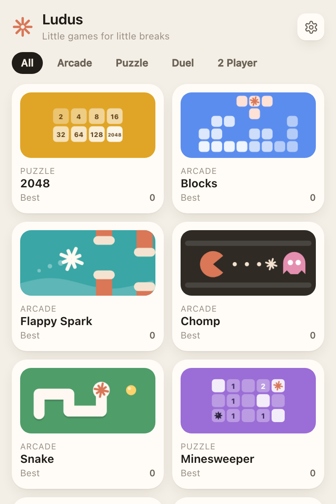
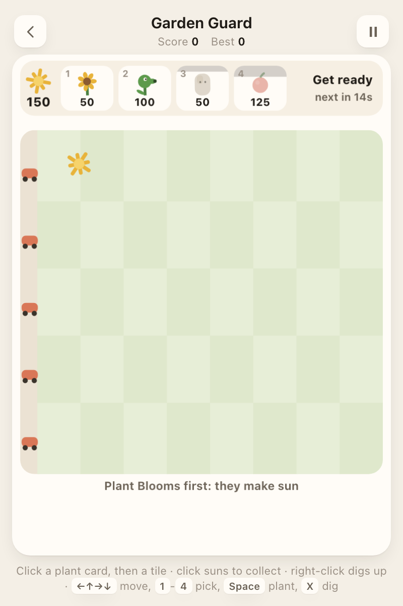
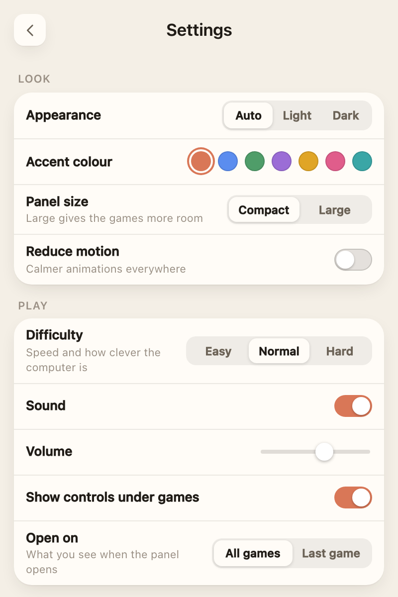

# Ludus

**Little games for little breaks.**

Ludus is a small panel of games that lives in the Mac menu bar or the Windows system tray.
Click the controller icon, play a quick round, click anywhere else and it tucks itself away,
paused, ready for next time. It is free, open source, works fully offline and collects nothing.






## Download

| | Download | Needs |
| --- | --- | --- |
| Mac | [Ludus-mac.zip](https://github.com/Solomon-69/Ludus/releases/latest/download/Ludus-mac.zip) | macOS 14 Sonoma or later, Apple silicon |
| Windows | [Ludus-windows.zip](https://github.com/Solomon-69/Ludus/releases/latest/download/Ludus-windows.zip) | Windows 10 or 11, 64-bit |

All versions are on the [Releases page](https://github.com/Solomon-69/Ludus/releases). There is also
a download page in [`docs/index.html`](docs/index.html), ready for GitHub Pages.

## Install

### Mac

1. Open `Ludus-mac.zip`. You get `Ludus.app`.
2. Drag `Ludus.app` into **Applications**.
3. First time only: right-click Ludus in Applications and choose **Open**, then **Open** again.
   If there is no Open button, go to **System Settings > Privacy & Security** and click
   **Open Anyway**. This is needed because the app is not notarised by Apple.
4. Click the controller icon in the menu bar.

### Windows

1. Right-click `Ludus-windows.zip` and choose **Extract All**. Keep the `Ludus` folder somewhere
   permanent (for example Documents); `Ludus.exe` and its `web` folder must stay together.
2. Run `Ludus.exe`. If SmartScreen says "Windows protected your PC", click **More info**, then
   **Run anyway**. This is because the app is not code signed.
3. If Windows asks for the **.NET 8 Desktop Runtime** or the **WebView2 Runtime**, accept the
   free Microsoft download. (WebView2 is built into Windows 11.)
4. Click the controller icon in the system tray (it may be behind the small arrow).

## The games

Arcade (beat your best score): Blocks, Breakout, Chomp, Drift, Flappy Spark, Garden Guard,
Hammer Climb, Sky Raiders, Snake, Spark Hop, Stack.

Puzzle: 2048, Crates, Five Letters, Minesweeper, Pairs, Patience, Spark Match, Sudoku.

Duel (you against the computer): Box It, Dead Centre, Four Up, Last Wire, Nine Squared,
Right of Way, The Crossing, The Decider, Wall Run.

2 Player (two people, one keyboard): Air Puck, Light Trails, Rally, Tag, Tank Duel.

Each game lives in its own file in [`web/games/`](web/games); the list above was taken from
their `register()` calls and grows with new releases.

## Controls

| Where | Keys |
| --- | --- |
| Menu bar or tray icon | Click to open or close the panel. Clicking anywhere else closes it and pauses the game. |
| In a game | Arrow keys (or WASD in many games), Space to act. Each game shows its controls under the play area. |
| Pause | `Esc` or `P` (in Five Letters `P` types a letter, so use `Esc`) |
| Game over | `Enter`, `Space` or `R` to play again, `Esc` for all games |
| Settings | `Esc` to go back |
| 2 Player games | Both players share the keyboard (one on WASD, one on the arrow keys) |

Settings (gear icon): appearance (Auto, Light, Dark), accent colour, panel size (Compact or
Large), reduce motion, difficulty (Easy, Normal, Hard), sound and volume, show controls,
open on (all games or last game), open at login, reset best scores, quit.

## Build from source

The games are plain HTML, CSS and JavaScript in [`web/`](web), shared by both apps. You can
also open `web/index.html` in a browser to try them (scores then live in browser storage).

### Mac

Needs macOS 14+ on Apple silicon and the Xcode command line tools (`xcode-select --install`).

```bash
./build.sh               # builds Ludus.app and installs it to ~/Applications
./build.sh --no-install  # only builds (output in /private/tmp/ludus-build)
```

Options, as environment variables:

- `SIGN_ID`: code signing identity. Defaults to `-` (ad-hoc). Set it to your own, for example
  `SIGN_ID="Developer ID Application: Your Name (TEAMID)" ./build.sh`.
- `LUDUS_OUT`: where to build (default `/private/tmp/ludus-build`).

The app is a single Swift file ([`Sources/App.swift`](Sources/App.swift)): an `NSStatusItem` with an
`NSPopover` that hosts a `WKWebView` showing the bundled `web` folder.

### Windows

Needs the [.NET 8 SDK](https://dotnet.microsoft.com/download/dotnet/8.0) on Windows.

```powershell
cd windows
dotnet publish -c Release -r win-x64 --self-contained false -p:PublishSingleFile=true -o ..\out\Ludus
```

Details, file layout and the page bridge are in [`windows/README.md`](windows/README.md).

### Releases

Pushing a tag such as `v1.5` runs [`.github/workflows/release.yml`](.github/workflows/release.yml):
it builds both apps and attaches `Ludus-mac.zip` and `Ludus-windows.zip` to a GitHub Release.
[`ci.yml`](.github/workflows/ci.yml) builds both on every push and pull request.

### Signing

Release builds are unsigned (Mac: ad-hoc signature; Windows: none), which is why the first-open
steps above are needed. To remove them:

- **Mac:** an Apple Developer Program membership gives a "Developer ID Application" certificate.
  Sign with `SIGN_ID`, add the hardened runtime, and notarise with `xcrun notarytool`.
- **Windows:** sign `Ludus.exe` with a code signing certificate (`signtool sign`). SmartScreen
  warnings fade as a signed app builds up reputation.

## Privacy

Ludus collects nothing and never connects to the internet. Scores, saved games and settings
stay on your computer. See [PRIVACY.md](PRIVACY.md).

## Licence

[MIT](LICENSE). Copyright (c) 2026 Solomon. Third-party notices are in [NOTICE](NOTICE).

## Credits

- Made by Solomon, built with the help of Claude.
- Settings gear icon from [Lucide](https://lucide.dev) (ISC licence).
- Many of the games are fresh takes on classics (falling blocks, maze chase, Hex, Quoridor,
  dots and boxes, ultimate tic-tac-toe and more). The code and drawings were written for Ludus.

Ludus is an independent project and is not affiliated with or endorsed by Anthropic.
