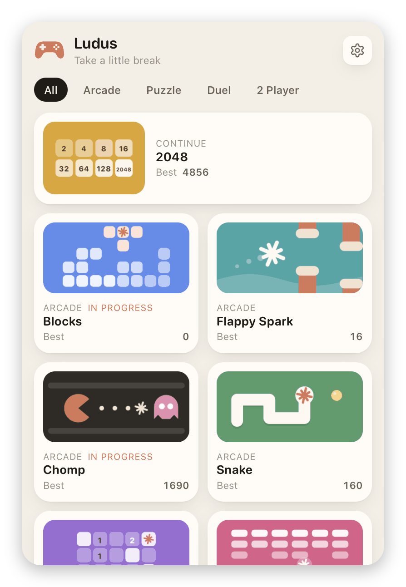
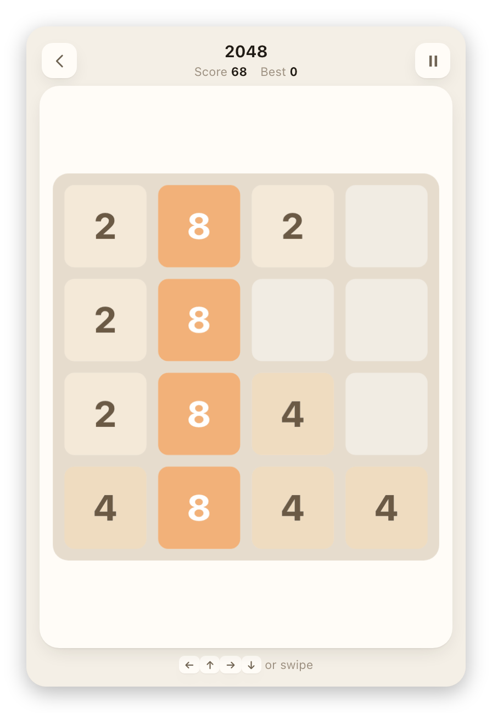
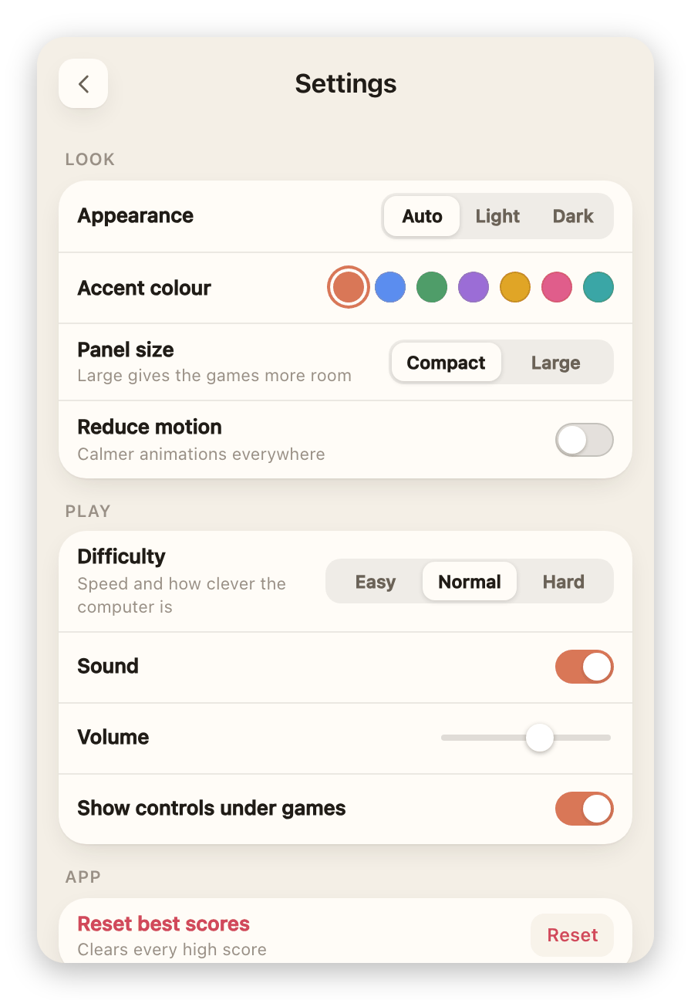

<div align="center">

<picture>
  <source media="(prefers-color-scheme: dark)" srcset="docs/img/icon-dark.png">
  
</picture>

<h1>Ludus</h1>

<p><b>33 little games in your menu bar. Take a little break.</b></p>

<p>
  <a href="https://github.com/Solomon-69/Ludus/releases/latest"></a>
  <a href="https://github.com/Solomon-69/Ludus/releases"></a>
  
  
  <a href="LICENSE"></a>
</p>

<p>
  <a href="https://github.com/Solomon-69/Ludus/releases/latest/download/Ludus.dmg"><b>Download for Mac</b></a>
  &nbsp;&middot;&nbsp;
  <a href="https://github.com/Solomon-69/Ludus/releases/latest/download/Ludus-windows.zip"><b>Download for Windows</b></a>
  &nbsp;&middot;&nbsp;
  <a href="https://solomon-69.github.io/Ludus/">Website</a>
</p>

<br>

<picture>
  <source media="(prefers-color-scheme: dark)" srcset="docs/img/panel-dark.png">
  
</picture>

</div>

Ludus is a small panel of games that lives in the Mac menu bar (and the Windows system tray).
Click the controller, play a quick round, then click anywhere else. The panel tucks itself
away and your game waits, paused, exactly where you left it.

It is free, open source, works fully offline and collects nothing.

## Contents

- [Features](#features)
- [Install](#install)
- [The games](#the-games)
- [Usage and keyboard shortcuts](#usage-and-keyboard-shortcuts)
- [Settings](#settings)
- [Privacy](#privacy)
- [Requirements](#requirements)
- [FAQ and troubleshooting](#faq-and-troubleshooting)
- [Building from source](#building-from-source)
- [Contributing](#contributing)
- [Credits](#credits)
- [Licence](#licence)

## Features

- **33 games in four groups.** Arcade, Puzzle, Duel (you against the computer) and 2 Player (two people, one keyboard).
- **Always one click away.** A single menu bar icon. No Dock icon, no windows to manage.
- **Pick up where you left off.** Close the panel mid-game and it pauses and saves. A Continue card takes you straight back.
- **Best scores and progress** for every game, stored on your Mac.
- **Light and dark.** Follows your Mac, or pick one. Seven accent colours.
- **Compact or Large panel.** Some games open a wider panel when they need the room.
- **Three difficulty levels** for the computer opponents and the arcade speed.
- **Keyboard first, mouse friendly.** Arrow keys or WASD, Space, Esc. Most games also work with clicks or swipes.
- **Light on your Mac.** One small native app. The games are plain HTML, CSS and JavaScript bundled inside it.
- **Invisible icon option** if you want an empty-looking menu bar. The spot still opens Ludus when clicked.
- **Offline and private.** No accounts, no ads, no analytics, no network access at all.

<table>
  <tr>
    <td align="center" width="50%">
      <picture>
        <source media="(prefers-color-scheme: dark)" srcset="docs/img/game-dark.png">
        
      </picture>
      <br><sub>Every game pauses and saves when the panel closes</sub>
    </td>
    <td align="center" width="50%">
      <picture>
        <source media="(prefers-color-scheme: dark)" srcset="docs/img/settings-dark.png">
        
      </picture>
      <br><sub>Appearance, panel size, difficulty, sound and more</sub>
    </td>
  </tr>
</table>

## Install

### Mac

1. Download **[Ludus.dmg](https://github.com/Solomon-69/Ludus/releases/latest/download/Ludus.dmg)** from the [latest release](https://github.com/Solomon-69/Ludus/releases/latest). A plain `Ludus-mac.zip` is there too if you prefer.
2. Open it and drag **Ludus** into **Applications**.
3. Open Ludus from Applications. A controller appears in your menu bar. Click it to play.

**First run on an unsigned build.** If a release is not notarised by Apple, macOS asks before
opening it the first time:

- Right-click Ludus in Applications and choose **Open**, then **Open** again.
- If there is no Open button, go to **System Settings > Privacy & Security**, scroll down and click **Open Anyway** next to Ludus.

You only need to do this once. Releases that are signed and notarised open straight away.

### Windows

1. Download **[Ludus-windows.zip](https://github.com/Solomon-69/Ludus/releases/latest/download/Ludus-windows.zip)**, right-click it and choose **Extract All**.
2. Keep the `Ludus` folder somewhere permanent, such as Documents. `Ludus.exe` and its `web` folder must stay together.
3. Run `Ludus.exe`. If SmartScreen says "Windows protected your PC", click **More info**, then **Run anyway**.
4. If Windows asks for the **.NET 8 Desktop Runtime** or the **WebView2 Runtime**, accept the free Microsoft download. WebView2 is built into Windows 11.
5. Click the controller in the system tray. It may be hidden behind the small arrow.

More detail for Windows is in [`windows/README.md`](windows/README.md).

### Install with Homebrew (coming soon)

There is no Homebrew tap yet. When there is, installing will be one line:

```sh
brew install --cask ludus   # not available yet
```

## The games

| Group | Games |
| --- | --- |
| **Arcade** (beat your best) | Blocks, Breakout, Chomp, Drift, Flappy Spark, Garden Guard, Hammer Climb, Sky Raiders, Snake, Spark Hop, Stack |
| **Puzzle** | 2048, Crates, Five Letters, Minesweeper, Pairs, Patience, Spark Match, Sudoku |
| **Duel** (you against the computer) | Box It, Dead Centre, Four Up, Last Wire, Nine Squared, Right of Way, The Crossing, The Decider, Wall Run |
| **2 Player** (one keyboard) | Air Puck, Light Trails, Rally, Tag, Tank Duel |

Each game lives in its own file in [`web/games/`](web/games).

## Usage and keyboard shortcuts

Click the controller in the menu bar to open or close the panel. Clicking anywhere else closes
it and pauses the game. A right-click on the icon works too.

| Where | Keys |
| --- | --- |
| Moving | <kbd>&larr;</kbd> <kbd>&uarr;</kbd> <kbd>&rarr;</kbd> <kbd>&darr;</kbd> or <kbd>W</kbd> <kbd>A</kbd> <kbd>S</kbd> <kbd>D</kbd> in most games |
| Act, jump, drop, fire | <kbd>Space</kbd> |
| Pause | <kbd>Esc</kbd> or <kbd>P</kbd> (in Five Letters, <kbd>P</kbd> types a letter, so use <kbd>Esc</kbd>) |
| After a game | <kbd>Enter</kbd>, <kbd>Space</kbd> or <kbd>R</kbd> to play again, <kbd>Esc</kbd> for all games |
| Settings | <kbd>Esc</kbd> to go back |
| 2 Player games | One player on <kbd>W</kbd> <kbd>A</kbd> <kbd>S</kbd> <kbd>D</kbd>, the other on the arrow keys |

Each game shows its own controls under the play area. You can turn that hint off in Settings.

## Settings

Open Settings with the gear in the top corner of the panel.

| Section | What you can change |
| --- | --- |
| **Look** | Appearance (Auto, Light, Dark), accent colour, panel size (Compact or Large), reduce motion |
| **Play** | Difficulty (Easy, Normal, Hard), sound and volume, show controls under games, open on all games or the last game |
| **App** | Open at login, invisible menu bar icon (Mac), reset best scores, quit |

## Privacy

Nothing leaves your Mac. Ludus has no accounts, no analytics, no ads and makes no network
connections. Scores, saved games and settings are stored locally. The game pages run in a
sandboxed web view that can only load files from inside the app. See [PRIVACY.md](PRIVACY.md).

## Requirements

- **Mac:** macOS 14 Sonoma or later, Apple silicon. On macOS 26 the app icon also has a dark version.
- **Windows:** Windows 10 or 11, 64-bit, with the .NET 8 Desktop Runtime and WebView2.
- About 5 MB of disk space.

## FAQ and troubleshooting

<details>
<summary><b>I can't see the icon in the menu bar.</b></summary>

On a busy menu bar, macOS hides icons that do not fit, especially on MacBooks with a notch.
Quit a few other menu bar apps, or hold <kbd>Command</kbd> and drag icons to make room. If you
turned on the invisible icon, the spot is still there: click where the controller used to be.
</details>

<details>
<summary><b>macOS says Ludus "cannot be opened" or is from an unidentified developer.</b></summary>

That build is not notarised. Right-click Ludus and choose **Open**, or use **Open Anyway** in
**System Settings > Privacy & Security**. See [Install](#install).
</details>

<details>
<summary><b>Where are my scores stored, and how do I reset them?</b></summary>

In the app's own preferences on your Mac. Use **Settings > Reset best scores**. To remove
everything, quit Ludus and run `defaults delete com.solomon.Ludus`.
</details>

<details>
<summary><b>Does Ludus use the internet?</b></summary>

No. It never connects to anything. It works the same with Wi-Fi off.
</details>

<details>
<summary><b>How do I start Ludus when I log in?</b></summary>

Turn on **Settings > Open at login**.
</details>

<details>
<summary><b>How do I uninstall it?</b></summary>

Quit Ludus from Settings, then move `Ludus.app` from Applications to the Bin. To clear its
saved data too, run `defaults delete com.solomon.Ludus`.
</details>

## Building from source

The games are plain HTML, CSS and JavaScript in [`web/`](web), shared by the Mac and Windows
apps. You can open `web/index.html` in any browser to try them (scores then live in browser storage).

### Mac

You need macOS 14 or later on Apple silicon and the Xcode command line tools
(`xcode-select --install`). There is no Xcode project.

```sh
git clone https://github.com/Solomon-69/Ludus.git
cd Ludus
./build.sh               # builds Ludus.app and installs it to ~/Applications
./build.sh --no-install  # only builds (output in /private/tmp/ludus-build)
```

Options, as environment variables:

- `SIGN_ID`: code signing identity. Defaults to `-` (ad-hoc), for example `SIGN_ID="Developer ID Application: Your Name (TEAMID)" ./build.sh`.
- `LUDUS_OUT`: where to build (default `/private/tmp/ludus-build`).
- `RELEASE=1`: leaves out the local UI test hook. CI uses this.

The app is a small Swift program in [`Sources/`](Sources): an `NSStatusItem` with an `NSPopover`
that hosts a `WKWebView` showing the bundled `web` folder.

### Windows

You need the [.NET 8 SDK](https://dotnet.microsoft.com/download/dotnet/8.0).

```powershell
cd windows
dotnet publish -c Release -r win-x64 --self-contained false -p:PublishSingleFile=true -o ..\out\Ludus
```

### Releases

Pushing a tag such as `v1.5` runs [`release.yml`](.github/workflows/release.yml). It builds both
apps and attaches `Ludus.dmg`, `Ludus-mac.zip`, `Ludus-windows.zip` and `SHA256SUMS.txt` to a
GitHub Release. If the Apple signing secrets are set in the repository, the Mac build is signed
with a Developer ID and notarised. If they are not, it is ad-hoc signed and the release notes say
so. The secrets are listed at the top of the workflow file.

## Contributing

Bug reports, ideas and pull requests are welcome. Please read [CONTRIBUTING.md](CONTRIBUTING.md)
first. New games are especially welcome: each one is a single file in `web/games/`.

To report a security problem, see [SECURITY.md](SECURITY.md).

## Credits

- Made by Solomon, built with the help of Claude.
- Settings gear icon from [Lucide](https://lucide.dev) (ISC licence).
- Many games are fresh takes on classics such as falling blocks, maze chase, Hex, Quoridor, dots
  and boxes and ultimate tic-tac-toe. The code and drawings were written for Ludus.
- Third-party notices are in [NOTICE](NOTICE).

Ludus is an independent project and is not affiliated with or endorsed by Anthropic or Apple.

## Licence

[MIT](LICENSE). Copyright (c) 2026 Solomon.
